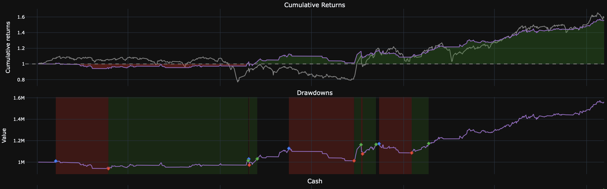
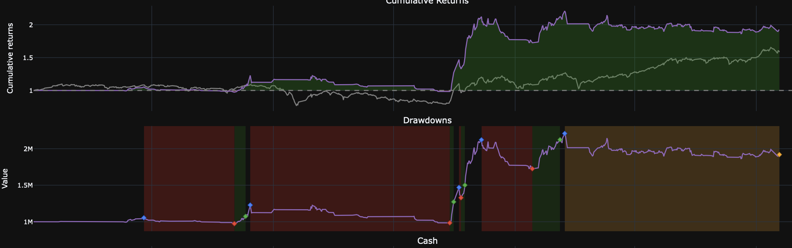

# 量化研究（个人兴趣）

研究时间 2025.12 -2026.02

使用强化学习，符号回归等等技术，在美股市场全量数据集中滚动挖掘因子，而后在全量A股市场数据集中进行验证。精选因子如下

alpha_US_94fd5000875c    三年全量回测夏普收益率    1.602 三个月滚动回测夏普收益率 R:2.161

alpha_US_089d8f944c00       三年全量回测夏普收益率    1.221  三个月滚动回测夏普收益率 R:0.749

技术栈为 Python, Pytorch, duckdb, vectorbt

具有成熟的数据清理入库管线以及因子从挖掘到回测的完整流程。此外，还搭建了个人量化 CLI 界面用于辅助选股与手动操作追踪。